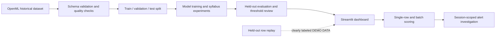

# AI-Powered Banking Transaction Fraud Detection and Risk Monitoring System

A complete, syllabus-informed machine-learning portfolio project and interactive Streamlit prototype. It uses a documented public fraud dataset, compares real trained models, scores individual and batch inputs, and provides a session-scoped alert workflow.

> **Prototype boundary:** the app returns a score immediately for submitted data and can replay held-out records as **DEMO DATA**. It is not connected to a bank, payment gateway, or live transaction feed, and must not be used to approve or decline real payments.

## What the dashboard includes

| Dashboard section | What it demonstrates |
|---|---|
| Executive dashboard | KPI cards, historical activity, time/amount filters, and model status |
| Introduction and objectives | Problem statement, goals, dataset snapshot, and syllabus summary |
| Dataset, EDA, and search | Data quality, imbalance, fraud/normal analysis, charts, row lookup, clustering, and outlier experiments |
| Training and evaluation | Decision Tree and Random Forest, confusion matrices, curves, global feature importance, model comparison, and amount regression |
| Advanced comparison and batch scoring | Cross-validation, validation-only cost thresholds, held-out evaluation, calibration, CSV scoring, HMM, and CRF |
| Individual fraud prediction | Editable real held-out example, immediate score, risk band, and global feature context |
| Fraud alerts and investigation | Filterable scored queue with session-only review statuses |
| Live-style DEMO DATA simulator | Start/stop controls replay held-out rows with generated demo IDs and timestamps |
| Model performance monitoring | Held-out metrics by time cohort and separately reported simulator statistics |
| System architecture | In-app workflow diagram and prototype boundaries |
| Conclusion and future scope | Limitations and responsible next steps |

Syllabus topics guide the additional experiments described in the relevant dashboard sections. There is no separate syllabus-only dashboard. The application labels experiments that are bounded teaching demonstrations and explains their limitations.

## Dataset and attribution

The application uses the public **Credit Card Fraud Detection** data listed as [OpenML dataset 1597](https://www.openml.org/d/1597). It contains 284,807 historical European card transactions, 492 fraud labels, `Time`, `Amount`, 28 anonymized features (`V1`-`V28`), and the binary target `Class`. `V1`-`V28` are PCA-transformed; their original business meanings are unavailable. Amount units are not specified by the data description.

On first start, the app downloads the parquet source file from OpenML and caches it at `data\creditcard.parquet`. This file is intentionally excluded from source control. The original source and attribution notes are in [data/README.md](./data/README.md). An internet connection is needed for the initial download.

## Run on Windows

### Fastest option

1. Install Python 3.11 or newer.
2. Double-click [run_dashboard.bat](./run_dashboard.bat) from File Explorer.
3. Keep its console open. The first run creates `.venv`, installs dependencies, and starts the app; the first app start also downloads the dataset.
4. Open the **Local URL** shown in the console, normally `http://localhost:8501`.

### PowerShell setup

Open PowerShell in this project folder and run:

```powershell
py -m venv .venv
.\.venv\Scripts\Activate.ps1
python -m pip install --upgrade pip
python -m pip install -r requirements.txt
python -m streamlit run app.py
```

If PowerShell prevents environment activation, use the virtual environment directly:

```powershell
.\.venv\Scripts\python.exe -m pip install -r requirements.txt
.\.venv\Scripts\python.exe -m streamlit run app.py
```

Leave the terminal open while using the dashboard. Stop the local app with `Ctrl+C`.

### First demonstration workflow

1. Start on **Executive dashboard** and change the time and amount filters.
2. Open **Dataset, EDA, and search**. Explain the rare fraud class, the charts, and why accuracy alone is not enough.
3. Open **Training and evaluation** and click **Train and compare models**. The first training run may take a few minutes.
4. Review the actual computed metrics, confusion matrices, curves, and feature importance. Then try the syllabus algorithm comparison.
5. Open **Advanced comparison and batch scoring** for cross-validation, cost-sensitive thresholding, and CSV upload/download.
6. Open **Individual fraud prediction** and submit an unchanged or edited held-out row. An unchanged example also shows its recorded historical label; edited examples do not claim a known label.
7. Open **Fraud alerts and investigation** to filter flagged examples and change a review status.
8. Open **Live-style DEMO DATA simulator**, start the stream, and point out the repeated **DEMO DATA** labeling. Stop the stream after the demonstration.
9. Finish with **Model performance monitoring**, **System architecture**, and **Conclusion and future scope**.

## Machine-learning methodology

- The genuine dataset is schema-checked; non-finite values and invalid targets are rejected.
- The main Decision Tree/Random Forest and advanced model workflows use stratified splits. The advanced workflow performs cross-validation on development data, selects thresholds from a separate validation set, and reports final results on a held-out test set.
- The algorithm comparison reports metrics from the same test rows for the selected candidates. Scaling and feature selection are fitted inside training pipelines.
- Imbalance is handled with class weights where supported. The held-out test data is not oversampled.
- Accuracy, precision, recall, F1-score, balanced accuracy, average precision, ROC AUC, and confusion matrices are computed from real held-out labels and model predictions. The app does not ship hard-coded score tables.
- Accuracy alone is misleading when normal transactions dominate: a model can classify nearly all rows as normal and still fail to identify fraud.
- Unsupervised methods fit transaction features without using `Class`; the label is only compared after fitting.
- Amount regression is a separate task predicting observed `Amount`, not a fraud classifier.
- HMM/CRF experiments use the global time-ordered stream because this dataset has no customer IDs. They do not model customer histories.
- Q-learning/DQN use an explicitly stated teaching reward assumption and an offline split of scored historical examples. There are no recorded bank decisions, responses, or true reward data.

## Project structure

```text
app.py                       Streamlit multipage navigation
app_pages\                   Dashboard pages
data_processing.py           Feature validation and dataset quality checks
fraud_detection.py           Dataset loading, core models, and evaluation
model_training.py            Syllabus classifier factories and comparisons
additional_experiments.py    Amount regression and unsupervised methods
sequence_experiments.py      HMM and linear-chain CRF experiments
rl_experiments.py            Assumption-based Q-learning and DQN experiment
prediction.py                Single-transaction validation and scoring
advanced_models.py           Cross-validation, thresholding, and batch scoring
prototype_utils.py           Alert queue and DEMO DATA event helpers
data\README.md               Dataset source, attribution, and local setup
data\sample_transactions.csv Header-only feature template; add real feature rows
tests\                       Automated tests
```

The end-to-end architecture diagram is also documented below and rendered in the app's **System architecture** page:



The workflow is inspired by the analysis structure of [RobertRusev/ML-FinFraud-Detector](https://github.com/RobertRusev/ML-FinFraud-Detector). This project uses its own original modular implementation and the separately documented OpenML dataset rather than copying the reference code or using its dataset.

## Dataset-free template for uploads

The header-only [sample CSV](./data/sample_transactions.csv) documents the exact required input columns. Add transaction feature values before uploading; empty files are intentionally rejected. For scored input, provide exactly `Time`, `Amount`, and `V1` through `V28`, with finite numeric values and non-negative `Time`/`Amount`. The maximum batch size is 10,000 rows. The upload template contains features only and must not include the `Class` label.

## Tests and checks

Activate the environment, then run:

```powershell
python -m compileall -q .
python -m unittest discover -s tests -v
```

The tests cover the public dataset schema, real-data model training and metrics, threshold selection, cross-validation, and batch scoring. The dashboard also uses Streamlit's first-party `AppTest` framework for smoke checks during development.

## Optional Google Colab notebook experiments

Colab is suitable for running the Python experiments, but it does not automatically expose this local Streamlit website. In a new Colab notebook, clone your published repository and install its requirements:

```python
!git clone https://github.com/<your-username>/<your-repository>.git
%cd <your-repository>
!python -m pip install -r requirements.txt
```

Then load the real OpenML data and run an experiment in notebook cells:

```python
from fraud_detection import load_dataset
from model_training import compare_classifiers

transactions = load_dataset()
transactions.head()

comparison = compare_classifiers(
    ["Logistic Regression", "Random Forest"],
    training_rows=8_000,
    test_rows=5_000,
)
comparison["results"]["Random Forest"]["metrics"]
```

Colab will download the dataset into its temporary runtime; rerun the download after the runtime is reset. Avoid publishing notebooks that contain private data or credentials.

## Publish to GitHub

1. Create a new empty repository on GitHub (do not upload the parquet dataset).
2. In PowerShell, from this project folder, initialize Git and stage only source files:

   ```powershell
   git init
   git add app.py app_pages data_processing.py fraud_detection.py model_training.py additional_experiments.py sequence_experiments.py rl_experiments.py prediction.py advanced_models.py prototype_utils.py requirements.txt README.md data\README.md data\sample_transactions.csv tests .streamlit\config.toml .gitignore run_dashboard.bat
   git status --short
   ```

3. Review `git status --short` and confirm no `.venv`, secrets, credentials, or downloaded parquet file is staged.
4. Add the remote URL shown by GitHub and push:

   ```powershell
   git branch -M main
   git remote add origin https://github.com/<your-username>/<your-repository>.git
   git commit -m "Build banking fraud detection prototype"
   git push -u origin main
   ```

Git is not initialized automatically by this project. Replace the placeholders with your own GitHub account and repository.

## Limitations and responsible use

This is an educational research prototype. The historical data covers a short period, is anonymized, and may not generalize to current banking traffic. There are no customer identifiers, confirmed monetary-loss values, real bank decisions, or live feed. Feature importance is global, not a local causal explanation. A production system would need carefully governed data access, secure service integration, robust monitoring, audit trails, validated costs, privacy/fairness testing, and human-approved operating procedures.
